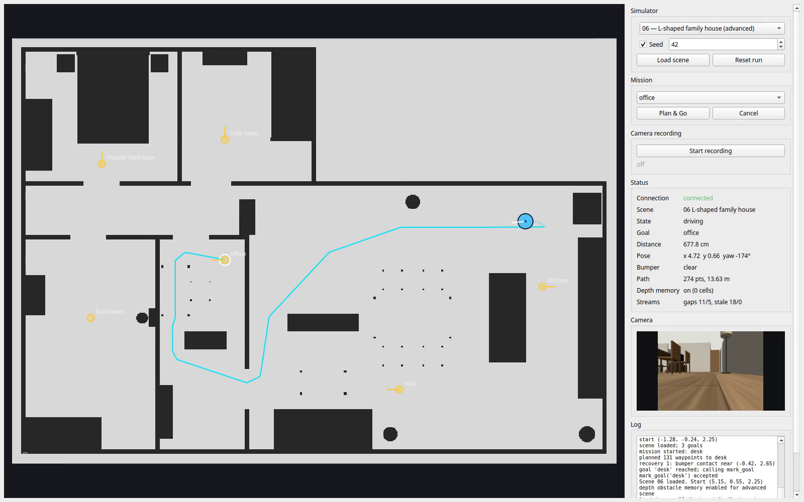

# Eureka Vacuum Console

A Python/Qt application that plans paths on the simulator's occupancy map, drives
the differential-drive vacuum robot to named goals, records its RGBD camera, and
visualises the live mission. The same mission controller is shared by the GUI and
a headless runner so behaviour can be tested without a display.



## Features

- Global A* planning on the supplied occupancy map, with obstacle inflation and a
  clearance cost so paths stay away from walls.
- Line-of-sight path smoothing and 5 cm resampling.
- Closed-loop pure-pursuit control with turn-in-place, speed reduction in tight
  spots, a slow final approach, yaw alignment and a four-tick goal verification
  before `mark_goal`.
- Robustness handling for the imperfect map: depth-based obstacle memory on all
  scenes, bumper-triggered recovery (reverse, rotate, replan), stuck detection,
  and bounded retries. Recovery falls back to planning without remembered
  obstacles when necessary.
- RGBD recording to H.264 RGB video plus lossless 16-bit FFV1 depth, with a
  per-frame JSONL manifest (simulation time, sequence, robot pose) and metadata.
- Qt visualiser: occupancy map, robot pose/heading, trail, planned path, goals
  and yaw, bumper state, status panel, RGB preview and event log.
- Headless runner for repeatable multi-scene tests and recordings.

## Requirements

- Python 3.10+
- Docker (for the simulator)
- FFmpeg/ffprobe on `PATH` (recording and validation)
- Linux or macOS; the GUI uses Qt 6 through PySide6

The code was developed and tested on Linux with Python 3.13, PySide6 6.12,
NumPy 2.x, pyzmq 27.x and FFmpeg 6.1.

## Install

```bash
cd vacuum-robot-control-app
python -m venv .venv
source .venv/bin/activate
pip install -e ".[dev]"
```

## Run the simulator

```bash
docker pull ghcr.io/eurekarobotics/vacuum-sim:1.0.0
docker run --rm -p 5555-5558:5555-5558 -p 8080:8080 \
  ghcr.io/eurekarobotics/vacuum-sim:1.0.0 --scene 01 --viewer
```

Open <http://localhost:8080> to see the 3D world. The application connects to
ports `5555`-`5558`.

## Run the GUI

```bash
vacuum                    # or: python -m vacuum
vacuum --recordings-dir /tmp/vacuum-recordings
```

The GUI auto-loads scene 01. Choose a scene and seed, press **Load scene**, pick
a goal, then **Plan & Go**. **Cancel** stops the current mission. Space starts
the selected goal; Escape cancels. **Start recording** records the RGBD camera;
press it again to stop and finalise the files. The status panel shows the active
mode, distance, pose, path length, bumper state, depth-memory state, stream gaps
and recording progress.

## Headless runs

```bash
vacuum-headless --scene 01 --seed 42 --goals all
vacuum-headless --scene 04 --seed 42 --goals all --timeout 120
vacuum-headless --scene 01 --seed 42 --goals kitchen,bathroom --record
vacuum-headless --scene 05 --seed 7 --goals all --json-out /tmp/scene05.json
```

Options:

| Option | Meaning |
|---|---|
| `--scene` | scene id, `01`-`06` |
| `--seed` | start-pose seed; omit for a random start |
| `--goals` | `all` or comma-separated goal names |
| `--timeout` | seconds per goal (default 150) |
| `--record` | record RGBD while driving |
| `--recordings-dir` | output directory (default `recordings/`) |
| `--depth` / `--no-depth` | explicitly enable/disable depth obstacle memory |
| `--json-out` | write the result summary as JSON |

Depth obstacle memory is enabled by default on all scenes. Use `--no-depth` for
comparison runs or if persistent camera obstacles cause an excessive detour.

## Camera recording format

A recording directory contains:

| File | Contents |
|---|---|
| `rgb.mp4` | H.264, RGB24, 640x480, nominal 15 fps |
| `depth.mkv` | FFV1 level 3, `gray16le`, millimetres (`value * depth_scale`) |
| `manifest.jsonl` | one JSON object per stored frame: `frame`, simulation `t`, `seq`, `pose` `[x, y, yaw]`, `dropped_before` |
| `meta.json` | scene, seed, size, fps, camera intrinsics/extrinsics, file names, frame/drop counts and errors |

Simulation time is the authoritative timing source; nominal video fps is only a
container default. The manifest and meta files make drops and variable timing
visible. See [docs/recording-format.md](docs/recording-format.md) for decoding
details and a reader example.

Validate any recording with:

```bash
python scripts/validate_recording.py recordings/example_scene01
```

An example produced by this software is in `recordings/example_scene01/`
(2 goals, 364 frames, 0 dropped). Large recordings are excluded from git by
default.

## Tests and linting

```bash
pytest
ruff check src tests scripts
```

The unit suite covers pose/angle helpers, map transforms and inflation, A*,
smoothing/LOS, pure pursuit, depth back-projection, the mission state machine,
and the recorder (when FFmpeg is installed).

## Results at seed 42

| Scene | Difficulty | Goals | Reached | Bumps | Time |
|---|---|---:|---:|---:|---:|
| 01 Studio apartment | easy | 4 | 4 | 0 | 64.9 s |
| 02 Two-room flat | easy | 4 | 4 | 0 | 96.6 s |
| 03 Family home | easy | 5 | 5 | 0 | 212.3 s |
| 04 Loft with divider | advanced | 3 | 3 | 0 | 151.9 s |
| 05 Apartment with hallway | advanced | 5 | 5 | 0 | 299.6 s |
| 06 L-shaped house | advanced | 6 | 6 | 0 | 232.9 s |

These numbers come from `vacuum-headless` runs on the provided simulator. The
advanced-scene results were rerun with the corrected robot-height depth filter
and depth explicitly enabled. All goals completed without contact. Scenes 04 and
05 still made several camera-triggered replans and took long alternative routes;
scene 06 required only two depth replans. Scenes are not tuned per start pose,
and timings vary with machine load.

## Design and decisions

- [Design note](docs/design.md): architecture, algorithms, trade-offs, known
  limitations and next steps.
- [Recording format](docs/recording-format.md): offline use of the camera data.
- [AI usage](docs/ai-usage.md): tools used while building this submission.

## Layout

```
src/vacuum/
  sim/          ZeroMQ RPC, command and stream transport
  model/        pose, occupancy grid, depth back-projection
  planning/     A*, line-of-sight smoothing, resampling
  control/      pure pursuit and the mission state machine
  recording/    RGBD recorder and metadata
  app/          shared controller and Qt worker thread
  ui/           main window and map canvas
  cli/          headless runner
scripts/        validation, scripted demo and screen-cast helpers
tests/          unit tests
docs/           design note, recording format, AI usage, screenshot
```

## Libraries

- PySide6 (Qt 6) for the GUI
- pyzmq for the simulator's ZeroMQ API
- NumPy for grids, depth and geometry
- Pillow for PNG/JPEG handling
- FFmpeg/ffprobe (external) for video encoding and validation
- pytest and Ruff for tests/linting

## Troubleshooting

- **Cannot reach simulator**: check the container is running and ports
  `5555`-`5558` are free; the app prints the connection error in the log.
- **Qt platform plugin error on Linux**: install the distribution's xcb
  libraries, or run headless with `vacuum-headless`.
- **Recording fails**: install FFmpeg and check the log; `meta.json` records
  encoder errors. Use `scripts/validate_recording.py` to diagnose incomplete
  recordings.
- **Old scene state after Load/Reset**: the client drains queued stream messages
  and resets sequence tracking after every load/reset.

## Known limitations

- The simulator pose is treated as ground truth; there is no SLAM or localisation.
- The map is assumed static; depth memory is a persistent heuristic, not a full
  local costmap. It is enabled by default after successful depth-enabled tests on
  scenes 04-06, but scenes 04/05 still showed inefficient alternative routes.
  Use `--no-depth` for comparison or when testing other seeds.
- Recovery is reactive and simple (reverse, rotate, replan), not a full
  wall-following or trajectory-repair policy.
- Videos use a constant nominal frame rate; use the manifest for exact timing.
- Depth video is lossless, so recordings are relatively large.
